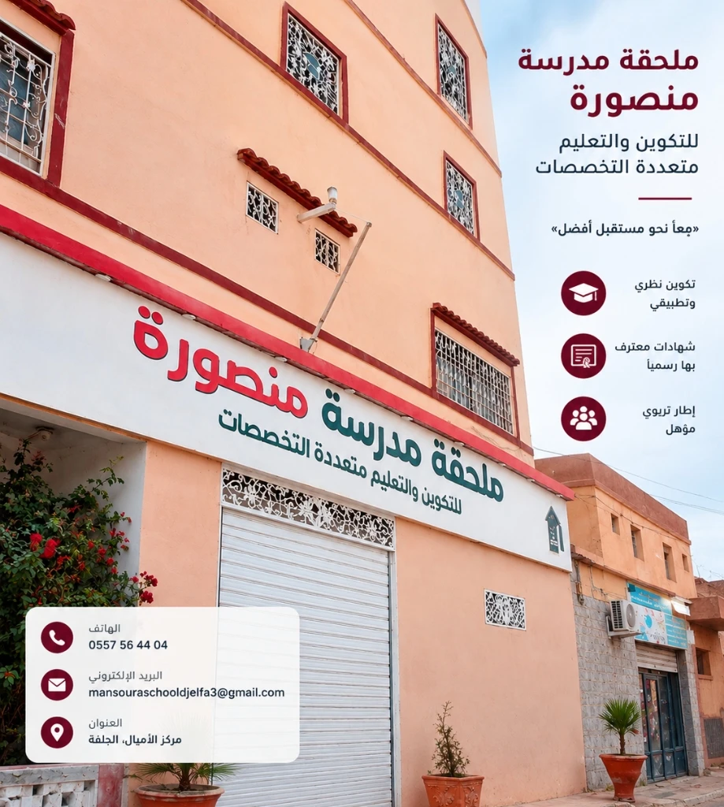

  

<h1 align="center">مدرسة منصورة للتكوين والتعليم — الجلفة</h1>

  <strong>Mansoura Vocational School Official Digital Campus & Cohort S3 Portal</strong> 
  <em>البوابة الرقمية الرسمية • فضاء طلبة دفعة S3 • منظومة الاعتماد الأكاديمي</em>

  
  
  
  
  

---

  

---

## عن المشروع (About The Project)

المنصة الرقمية الرسمية لـ **مدرسة منصورة للتكوين والتعليم بالجلفة** (المعتمدة من وزارة التكوين والتعليم المهنيين بالجزائر). صُممت المنصة لتكون واجهة حديثة للمؤسسة وفضاءً أكاديمياً متكاملاً لطلبة **السداسي الثالث (Cohort S3)** في تخصص قواعد البيانات والإعلام الآلي.

### أبرز ما تقدمه المنصة
- **البوابة الأكاديمية الرسمية**: استعراض البرامج التكوينية المعتمدة، هيئة التدريس، ومقر المدرسة بحي 05 جويلية بالجلفة.
- **فضاء دفعة السداسي الثالث S3**: رزنامة الدروس، برنامج المقاييس البيداغوجية، ومعرض مشاريع الطلبة.
- **الفضاء الأكاديمي والتوجيهي**: استعراض مسار التكوين، المقاييس النظرية والتطبيقية، ومرافقة مسار الامتياز المهني.
- **الهوية البصرية**: تصميم عصري ومخصص مستوحى من ألوان مدرسة منصورة الرسمية (العنابي والذهبي) ومتجاوب كلياً مع جميع الأجهزة.

---

## صاحب ومطور المشروع (Developer & Creator)

تم تطوير وهندسة هذه المنصة بواسطة:

  <h3><strong>حمزة — Hamza (VXL)</strong></h3>
  
<em>Full-Stack Builder</em>

  

    
  

- حساب غيتهوب: [`github.com/hamzavxl`](https://github.com/hamzavxl)
- بناء المنصة بتقنيات الويب الحديثة وتصميم واجهة مستخدم احترافية متكاملة وسريعة الاستجابة.

---

## التقنيات المستخدمة (Tech Stack)

| المجال | التقنية |
|:---|:---|
| **إطار العمل** | **Next.js 14** (App Router) |
| **لغة البرمجة** | **TypeScript** |
| **التصميم والواجهة** | **Tailwind CSS** + **Framer Motion** |
| **الأيقونات والرسوم** | **Handcrafted Vector SVGs** + **Lucide** |
| **الوسائط والصور** | **WebP Pipeline** (أصول خفيفة وسريعة التحميل) |

---

## الاعتماد وحقوق الملكية (Accreditation & Rights)

- **المؤسسة**: مدرسة منصورة الخاصة للتكوين المهني — معتمدة من طرف الدولة ووزارة التكوين والتعليم المهنيين، ولاية الجلفة، الجزائر.
- **التطوير والهندسة البرمجية**: جميع الحقوق محفوظة لـ [Hamza (VXL)](https://github.com/hamzavxl) — 2025/2026.
- **المستودع الرسمي لسورس كود المشروع**: [https://github.com/hamzavxl/mansoura](https://github.com/hamzavxl/mansoura)
